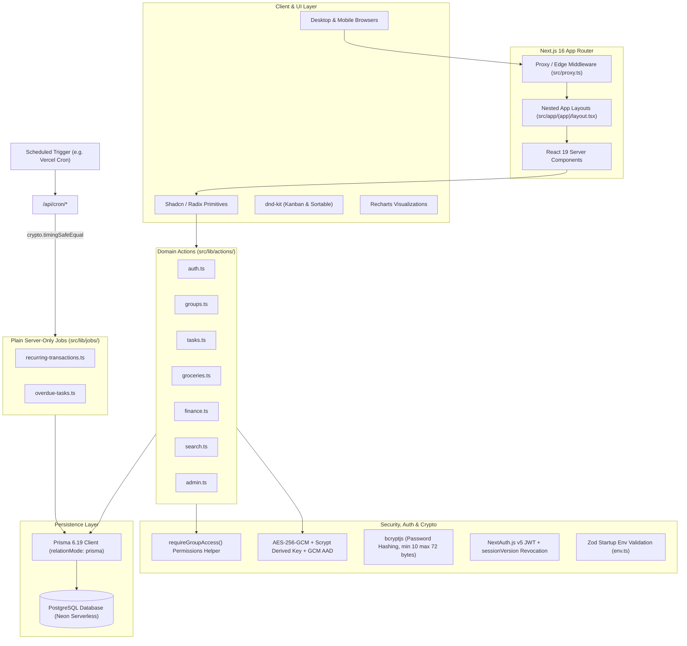
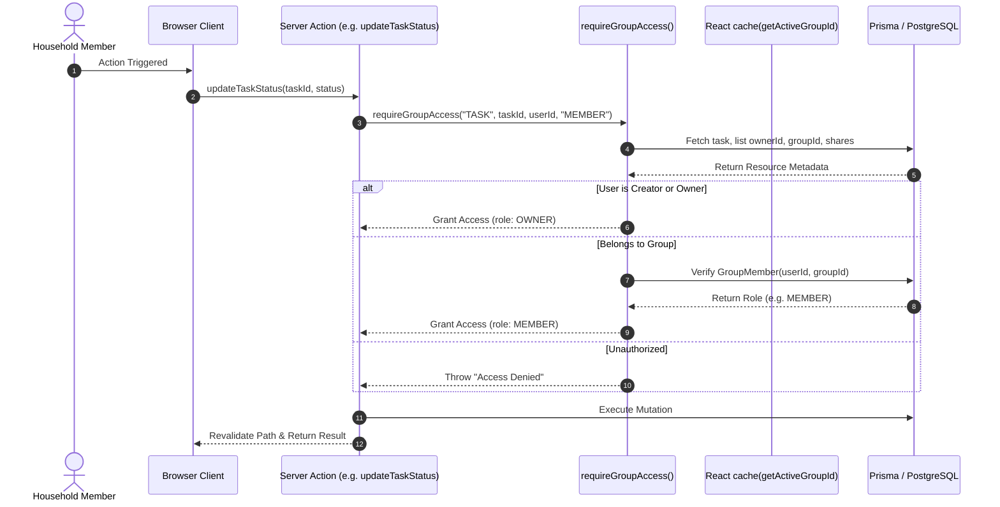
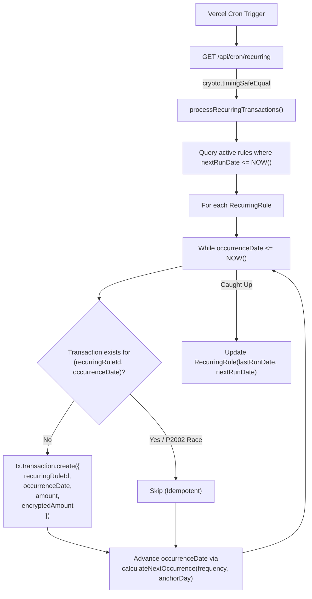

# LifeHub Architecture Blueprint

This document details the architectural design, security model, data pipelines, multi-tenant group scoping, cross-module synchronization, and data lifecycle of the LifeHub platform.

---

## 1. High-Level Architecture Overview

LifeHub is engineered as a modern, unified Next.js full-stack application leveraging the **App Router**, **Server Actions**, and **Prisma ORM** connecting to a serverless PostgreSQL instance.



---

## 2. Cryptographic Architecture & Threat Model

### Master Key Derivation & Performance Optimization
Previous implementations invoked `scryptSync` with a fresh 64-byte random salt on every single `encrypt()` and `decrypt()` operation, blocking the Node.js event loop during list rendering. 

LifeHub now optimizes cryptographic derivation:
1. **Startup Derivation**: A single 32-byte master key is derived once using `scryptSync` with a fixed domain salt (`lifehub-master-domain-salt-v1`) and cached in memory.
2. **Standard 12-Byte IV**: Each encryption operation generates a unique, cryptographically random 12-byte (96-bit) IV as recommended by NIST SP 800-38D for GCM mode.
3. **Key Versioning Header**: The output format prepends a 1-byte version header (`0x01`), enabling zero-downtime key rotation:
   ```
   [ Key Version (1 Byte) | IV (12 Bytes) | Auth Tag (16 Bytes) | Ciphertext ] -> Base64
   ```
4. **GCM AAD Record Binding**:
   Ciphertexts are cryptographically bound to their parent record using GCM Additional Authenticated Data (AAD):
   `cipher.setAAD(Buffer.from(userId, "utf8"))`
   If an adversary attempts to swap encrypted amounts between different users or database rows, the authentication tag verification fails immediately.

### Threat Model & Data Privacy: `amount` vs `encryptedAmount`
LifeHub stores financial amounts in both `amount Decimal` and `encryptedAmount String`:
- **Operational Need**: The plaintext `amount` column allows PostgreSQL to compute sub-millisecond aggregations (`_sum: { amount: true }`, category subtotals, and MoM deltas) without transferring the entire transaction table into Node.js application memory.
- **Cryptographic Role**: `encryptedAmount` serves as a verifiable integrity proof and satisfies compliance scenarios where encrypted payload backups are archived separately from operational reporting tables.
- **Key Backup**: Because all encrypted records depend on `ENCRYPTION_KEY`, losing this key prevents decryption. In production, store this secret in an Enterprise Key Management Service (AWS KMS, GCP KMS, or HashiCorp Vault) with automated backup.

---

## 3. Multi-Tenant Group Scoping Architecture

LifeHub isolates resources using a lightweight, flexible group tenancy model. Rather than enforcing rigid tenant boundaries at the connection string level, isolation is enforced logically via:
1. `groupId` foreign keys on core resource tables (`TaskList`, `GroceryList`, `PantryItem`, `Transaction`, `Budget`, `RecurringRule`).
2. An active context cookie (`active_group_id`) verified on each server action call, wrapped in React `cache()` for request-scoped deduplication.
3. Access boundary enforcement via `requireGroupAccess(kind, resourceId, userId, minRole)`.



---

## 4. Idempotent Recurring Ledger Engine

Recurring transactions are managed by dedicated `RecurringRule` records rather than loose transaction flags:



### Month-End Anchor Pinning
When a monthly recurring rule starts on the 31st (e.g., January 31), standard JavaScript `date.setMonth(date.getMonth() + 1)` rolls into March 3 in February. LifeHub's `calculateNextOccurrence` retains the original anchor day:
- January 31 $\rightarrow$ February 28 (or 29 in leap years) $\rightarrow$ March 31 $\rightarrow$ April 30.

---

## 5. Cross-Module Shopping Pipeline: Atomic Groceries $\rightarrow$ Finance $\rightarrow$ Pantry

When a shopping session completes, `finalizeShoppingSession` executes inside a single `prisma.$transaction`:

1. **Idempotency Check**: Queries only items in status `PENDING`. If already processed, it exits without creating duplicate expenses or inventory items.
2. **Proportional Receipt Reconciliation**:
   If a shopper enters a `manualTotal` that differs from the sum of item prices (due to bag fees, sales tax, or store coupons), LifeHub calculates:
   $$\text{scaleFactor} = \frac{\text{manualTotal}}{\text{calculatedTotal}}$$
   Each category expense is scaled proportionally:
   $$\text{categoryAmount} = \text{round}(\text{categorySubtotal} \times \text{scaleFactor}, 2)$$
3. **Pantry Stock Merging**:
   When ingesting purchased items into the Smart Pantry, LifeHub checks for existing active stock matching the same item name, unit, and location. If found, it increments `quantity` rather than creating duplicate rows.

---

## 6. JWT Session Revocation Architecture

NextAuth v5 stateless JWT sessions are fortified against credential changes and account deactivations:
- When a user's password is changed (`changePassword`), reset by an admin (`resetUserPassword`), or the account is deactivated (`deactivateUser`), the system atomically increments `sessionVersion`:
  `prisma.user.update({ data: { sessionVersion: { increment: 1 } } })`
- On every JWT verification cycle, `src/lib/auth.ts` queries `sessionVersion`, `isActive`, and `deletedAt`. If a token's embedded version does not match the database, the token is rejected immediately, logging the user out across all devices.

---

## 7. Relation Mode & Database Cascades

Because LifeHub runs with `relationMode = "prisma"` on serverless PostgreSQL (Neon):
- **No Foreign Key Locks**: DDL operations and distributed serverless queries run without table-level foreign key contention.
- **Manual Cascades**: Destructive actions (`deleteUser`, `deleteGroup`) explicitly clean up dependent entities inside `prisma.$transaction` across tasks, grocery items, pantry goods, transactions, and invitations.
- **Point-in-Time Recovery (PITR)**: For production deployments on Neon, ensure PITR is enabled with at least a 7-day retention window to safeguard against accidental administrative purges.
